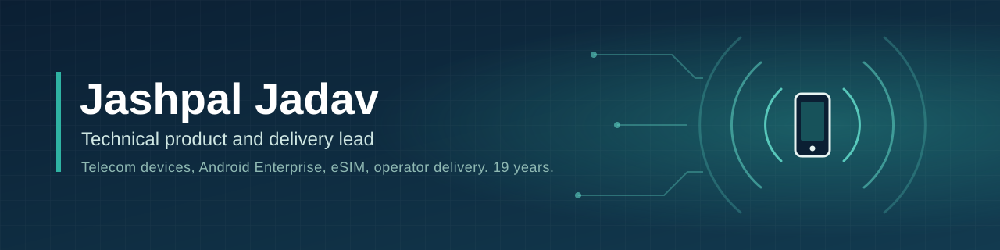

# Jashpal Jadav

I spent 19 years at Santok Group, a UK telecom and mobile device company, starting as a part-time test engineer and finishing as Technical Head (2016 to April 2026). Most of my work sat between mobile operators, factories in China and software teams. I wrote the requirements, tested the firmware, read the logs when something broke, and got devices through operator validation.

I am currently looking for product, project and technical management roles in the UK.

## Things I have worked on

Tecdesk desk phones for Vodafone Italy, Orange Spain, BT, Vodafone UK, Three UK and Telenor Denmark. These ran on Android, RTOS and, in the case of the 4G Voice Box, no screen at all. The Voice Box moved landline customers onto the mobile network.

Tecdesk Model 6 for SFR (2025 to 2026). I led the 4G software delivery and made around six trips to SFR's lab at Villejust, where we compared Cisco Call Manager logs with the chipset logs to find where the phone and the backend disagreed.

Santok After System (SAS), a web-based returns platform I designed in 2010, including the screens, and had built by outside developers over two years. It replaced a returns process run on Excel and email, connected Vodafone's system, a logistics partner and our repair centre, and handled about 5,000 returns a month. Other repair companies later paid a monthly subscription to use it.

Monqi, a child-safety smartphone sold through Carphone Warehouse. It was built on the STK Sync 5e with a custom Android parental-control OS, and I worked on its UX and UI.

Device programmes for clinical-trial companies including Signant Health, Clario, IQVIA and Eli Lilly, with devices managed through IBM MaaS360. This included an eSIM evaluation of SGP.22 against SGP.32.

SIP software, an LDAP server and a web-based manager for SIP phones.

## Technical background

Android and Android Enterprise, RTOS devices, SIP and VoIP, 4G and eSIM, Qualcomm, Unisoc and MediaTek chipsets, RF testing in Faraday cages, Zigbee and Bluetooth, MDM.

Tools I use: Jira, Trello, Wrike, SharePoint and SAP.

## Certifications

- Android Enterprise Certified Professional, Google (2025)
- Android Enterprise Certified Associate, Google (2025)
- AI Fundamentals, IBM (2026)
- IBM Garage Essentials, IBM (2026)
- PRINCE2 (in progress)

## Education

- MBA (Finance), Cardiff Metropolitan University
- BSc (Hons) Information Technology, University of East London
- Engineering Diploma in Computer Science, KSIT College Bangalore

## Contact

- LinkedIn: [linkedin.com/in/jashpaljadav26261818](https://www.linkedin.com/in/jashpaljadav26261818)
- Email: Jashpal@icloud.com
